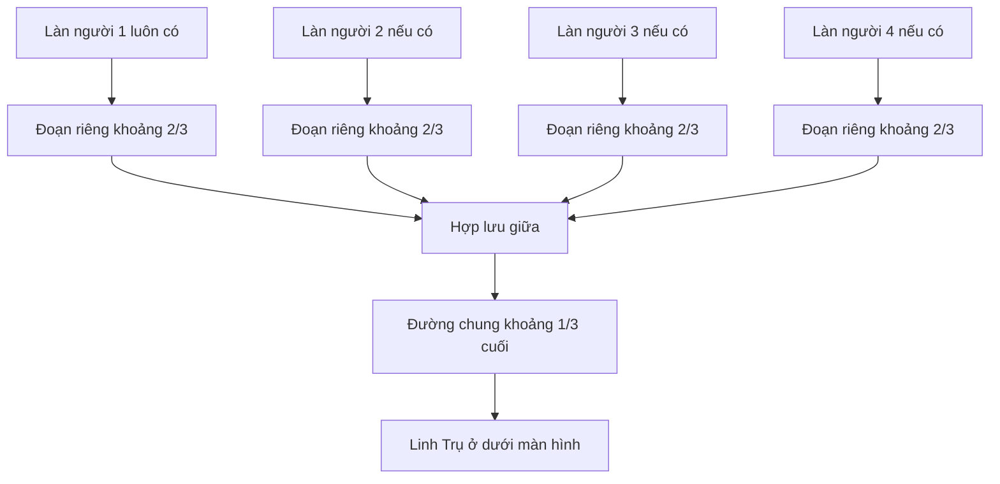

# Giai đoạn 2: Làn theo số người rồi hội tụ giữa

Layout/route và camera đã triển khai; xem [QA gameplay](./reports/playability-qa.md). QA browser nhiều client/reconnect đầy đủ vẫn mở.

## Bối cảnh và mục tiêu

[Tổng kế hoạch](./plan.md), [khảo sát source](./reports/current-state-audit.md), [phase 1](./phase-01-start.md). Rollout sau phase 1 để kiểm tra đường đi bằng điều khiển mới; có thể thiết kế tuyến trước nhưng không nghiệm thu rời bộ input/orders.

Đã chốt: **một người một làn sinh quái, từ 1 đến 4 làn hiện trên bản đồ**. Khi có ít nhất hai làn, quái đi riêng khoảng 2/3 tiến trình rồi nhập đường giữa chung ở 1/3 cuối. Solo chỉ có một làn giữa. Quái phải hiện đi **từ trên xuống dưới** màn hình.

Hiện core sinh tại `z=-28`, laneX `[-24,-8,8,24]`; quái zone 0 chỉ tăng z và leak ở 19. Renderer luôn vẽ bốn làn, trong khi spawnBatch chạy một lần cho mỗi player trong state. Camera alpha `-π/2` không đủ chứng minh hướng người dùng nhìn: phải xác nhận browser sau thay đổi.

## Yêu cầu

- Cảnh và simulation dùng đúng số làn 1/2/3/4 theo số người trong trận; làn không có người không hiển thị và không sinh quái. Mỗi người có đúng một cửa vào/làn nguồn. Solo dùng một tuyến ở giữa; nhiều làn có đoạn riêng dễ phân biệt, hợp lưu khoảng hai phần ba tiến trình rồi đi chung tới trụ.
- Tỷ lệ là **xấp xỉ** theo tiến trình dọc bản đồ; đoạn chéo có thể làm độ dài thực các tuyến khác nhau. Dùng landmark rõ ràng và waypoint đơn giản, không cân bằng độ dài từng tuyến bằng thuật toán phức tạp. Ghi tọa độ/tỷ lệ thiết kế khi triển khai, kiểm bằng ảnh và thời gian đi thực.
- Vùng phòng thủ chung có năm vị trí mỗi owner, tối đa 20 quân; tách vùng/nhãn màu cho dễ đọc. Bảo toàn năm slot và quyền quân hiện tại, không biến thành army chung.
- Geometry dùng chung cho core và renderer để quái đi đúng trên đường đã vẽ. Bounds order/offset, marker triển khai, camera focus/reset cùng xuất phát từ layout này.
- Quái gặp quân thì dừng đánh, hết giao chiến tiếp tục đúng waypoint cũ; không reset về đầu route/teleport sang lane khác. Slow, boss, 1×/2×/4× hoạt động.
- Tới endpoint base mới leak và xóa đúng một lần. Giữ nguyên luật timeout wave hiện có (quái còn lại gây leak khi hết giờ), tránh xử lý cả endpoint lẫn timeout hai lần.
- Boss trong dungeon vẫn chase quân trong zone riêng; không gán route chính cho boss dungeon, không đổi layout phụ bản ngoài ảnh hưởng lifecycle cần thiết.
- Số làn được xác định từ số thành viên đã vào trận, không phải số WebSocket đang kết nối. Người rớt mạng còn giữ chỗ 60 giây và quân vẫn chiến đấu nên làn của họ vẫn hoạt động; không tạo/xóa làn do mất mạng tạm thời. Trước khai trận, người rời sảnh làm bố cục và seat cập nhật theo danh sách còn lại.

## Kiến trúc

Với một người, A đi thẳng từ tuyến giữa tới Linh Trụ; không vẽ nút hợp lưu giả. Chỉ các làn thực có người mới xuất hiện trong scene và sinh quái.

Module layout thuần trong game-core xuất các polyline spawn→đoạn riêng→hợp lưu→base, vùng đi hợp lệ và placement theo seat/slot. Client đã import rules từ core nên tái dùng hướng phụ thuộc này, không tạo service cấu hình mới.

Enemy chính có `sourceLane`/route ID và tiến độ waypoint authoritative. `owner` hiện là nguồn player sinh quái, **không** là quyền quyết định ai được đánh; tách metadata tuyến khỏi quyền sở hữu unit. Khi hội tụ không đổi owner thành người gần nhất. Kill không cho tài nguyên; phần thưởng wave được xử lý ở phase 3.

Route walker nhận distance budget `speed × dt × slowFactor`, đi tới waypoint rồi dùng phần còn lại qua các đoạn tiếp theo cùng tick; guard đoạn dài 0/endpoint. Không chỉ tăng index và bỏ quãng dư ở tick nhanh. Offset spawn ngang giới hạn và thu về tuyến trước merge; không teleport khi bắt đầu route.

Shared defense placement thay logic slotPosition gắn lane owner; layout định vị trí cho 1/2/3/4 seat, ổn định trong trận và chỉnh seat khi người rời lobby theo policy hiện có. Save-position trong khu vực hợp lệ vẫn có ưu tiên khi respawn/return; không âm thầm xóa H/N. Vì state RAM/version mới, không hứa migration vị trí của trận release cũ.

## Tệp liên quan

| Hành động | Đường dẫn tuyệt đối | Nội dung |
|---|---|---|
| Tạo | `D:\HeroDefense\packages\game-core\src\battlefield-layout.ts` | Routes/landmarks/bounds/placements theo 1–4 seat dùng chung. |
| Sửa | `D:\HeroDefense\packages\contracts\src\types.ts` | Metadata route/waypoint cho enemy nếu snapshot cần. |
| Sửa | `D:\HeroDefense\packages\game-core\src\simulation.ts` | Chọn sourceLane/spawn và khởi tạo tiến độ. |
| Sửa | `D:\HeroDefense\packages\game-core\src\combat.ts` | Đi waypoint zone 0, dừng/tiếp tục và leak. |
| Sửa | `D:\HeroDefense\packages\game-core\src\rules.ts` | slotPosition dùng defense placement, bounds/helper dùng chung. |
| Sửa | `D:\HeroDefense\packages\game-core\src\commands.ts` | Bounds order/saved position/offset nhất quán map. |
| Sửa | `D:\HeroDefense\packages\game-core\src\roster.ts`, `D:\HeroDefense\packages\game-core\src\state.ts`, `D:\HeroDefense\packages\game-core\src\dungeons.ts` | Deploy/swap, lobby seat removal, respawn/return cùng placement. |
| Sửa | `D:\HeroDefense\apps\client\src\battlefield.ts`, `D:\HeroDefense\apps\client\src\main.ts` | Vẽ polyline, khu đội, camera reset/focus, zone selection. |
| Sửa | `D:\HeroDefense\apps\client\src\panels.ts`, `D:\HeroDefense\apps\client\src\styles.css` | Nhãn khu phòng thủ/làn, nhận diện đội, hướng dẫn phối hợp. |
| Sửa | `D:\HeroDefense\packages\game-core\test\combat.test.ts`, `D:\HeroDefense\packages\game-core\test\commands.test.ts`, `D:\HeroDefense\packages\game-core\test\progression.test.ts`, `D:\HeroDefense\packages\game-core\test\fixtures.ts` | Regression layout, movement, lifecycle, full progression. |
| Tạo | `D:\HeroDefense\packages\game-core\test\battlefield-layout.test.ts` | Polyline/budget/merge/placement invariants. |
| Sửa | `D:\HeroDefense\apps\server\test\network.test.ts`, `D:\HeroDefense\apps\client\test\game-session.test.ts` | Snapshot đồng bộ route/placement, reconnect. |
| Cập nhật sau implementation | `D:\HeroDefense\README.md`, `D:\HeroDefense\docs\gameplay-spec.md` | Map/defense/session và policy đã chốt. |

Không xóa file, không thêm navmesh hay hệ physics chung.

## Bước thực hiện

1. Chốt bản phác waypoint/landmark cho 1/2/3/4 làn; kiểm screen orientation bằng browser hiện tại trước khi chọn camera alpha/target mới. Đặt spawn phía trên, Linh Trụ phía dưới trong view mặc định.
2. Viết layout tests và route budget tests. Tách geometry khỏi renderer; tạo đúng số route theo thành viên trong trận, cùng tail khi nhiều làn, đánh dấu sourceLane và tiến độ authoritative.
3. Đổi chỉ nhánh enemy zone 0 sang route walker; giữ combat pause/slow/boss/dungeon/timeout. Khởi tạo mọi enemy đúng contract, kể cả fixture và dungeon không có route chính.
4. Chuyển toàn bộ deploy/swap/respawn/saved return/dungeon return/lobby seat removal sang placement chung; test khác owner không chồng slot. Giới hạn move offsets và saved positions theo map mới.
5. Vẽ đúng 1–4 nhánh đang hoạt động và tail chung khi cần từ cùng geometry; sửa marker/landmark/camera, kiểm pick ground/selection tại đường chéo và hợp lưu. Nút focus player hướng tới khu đội thay vì lane cũ nếu phù hợp.
6. Log bounded khi spawn route, vượt waypoint bất thường, leak và invalid destination; không log mỗi bước đi. Reuse client/server debug đang có; ghi số route/count/reason, không tên/token.
7. Chạy tests rồi browser 1/2/3/4 client: chỉ hiện/sinh quái trên làn có người, hỗ trợ chéo lane, đội tụ giữa, split dungeon/main, chết/return/reconnect/host transfer. Soát mỗi người một làn trước/sau rời lobby và khi ngắt mạng tạm thời.

## Kiểm tra và điều kiện hoàn tất

Từ `D:\HeroDefense`: `npx vitest run packages/game-core/test/battlefield-layout.test.ts packages/game-core/test/combat.test.ts packages/game-core/test/commands.test.ts` → `npm run test:core` → `npm run test:server` → `npx vitest run apps/client/test` → `npm run typecheck` → `npm test` → `npm run build`.

- [ ] Với N=1/2/3/4 người, có đúng N làn hiển thị và sinh quái; mỗi người một làn. N>1 có đoạn riêng và chung tail, merge khoảng 2/3 tiến trình dọc map; N=1 đi tuyến giữa. Ảnh browser chứng minh quái từ trên xuống dưới.
- [x] Budget qua nhiều waypoint, đoạn zero-length, slow và tốc độ 4× không đứng khựng/skip route; endpoint gây leak một lần; timeout không trừ hai lần.
- [ ] Quái dừng khi đánh rồi tiếp tục cùng route; target death không reset progress; dungeon chase giữ đúng behavior.
- [ ] Deploy/swap/respawn/saved return/dungeon return/lobby seat removal đều dùng placements hợp lệ; tối đa 20 quân không mặc định chung một điểm.
- [ ] Browser 1/2/3/4 client thấy cùng route/position/HP, không điều khiển quân khác, không kéo quân zone ẩn; reconnect giữ số làn và state authoritative.
- [x] Test/typecheck/build pass và cập nhật docs: số làn theo số thành viên trận, ngắt mạng tạm thời giữ làn.

## Rủi ro và rollback

- Hợp lưu khiến quái chồng hình/chiến đấu nghẽn: đo mật độ, thời gian đến base và đọc mục tiêu; điều chỉnh bề rộng/offset nhỏ trong layout. Không tự thêm collision/pathfinder hoặc giảm wave volume.
- Tỷ lệ đường ngoài quá lệch cảm nhận hai phần ba: xem screenshot và thời gian đi, chỉnh đoạn chéo/landmark; không yêu cầu equal-distance toán học mọi route.
- N=1/3/4 người cho vị trí làn lệch hoặc tải khác ý định: đặt layout đối xứng theo N, test lượng spawn theo thành viên của state và đo cân bằng; không dùng số WebSocket đang connected để xóa làn khi người chơi rớt mạng.
- Camera mới làm picking đảo/hỏng dungeon: test screen-space input và zone riêng tại hai kích thước; sửa camera/layout thống nhất, không đảo tọa độ command tùy client.
- Rollback layout/route contract/server/client cùng release version và drain phòng RAM trước đổi. Không rollback một mình renderer để core đi ngoài đường vẽ.
